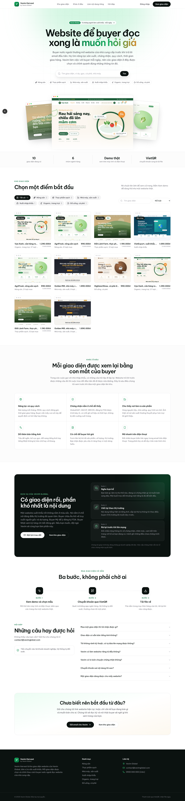

# Vexim Harvest

**Vexim Harvest** là dịch vụ bán giao diện website HTML của **Vexim Global**, dành cho doanh nghiệp
nông sản, thực phẩm, nhà máy sản xuất và xuất nhập khẩu.



## Tính năng

- **Landing page**: hero, lọc theo danh mục, tìm kiếm, sắp xếp. Lưới **4 giao diện/hàng** trên desktop (3 cột trên laptop nhỏ, 2 trên tablet, 1 trên điện thoại). Rê chuột lên ảnh thumbnail thì ảnh tự cuộn hết trang.
- **Trang chi tiết**: xem demo trực tiếp trong iframe sandbox, có nút đổi Desktop / Tablet / Mobile.
- **Demo an toàn**: `/demo/[slug]` trả về HTML kèm header `CSP: sandbox`, nên code trong giao diện không đọc được cookie hay phiên đăng nhập của site. Demo có gắn nhãn "Demo · Vexim Harvest".
- **Trang quản trị `/admin`**: dán HTML (hoặc chọn file .html) và xem trước ngay, điền thông tin, giá, giá khuyến mãi rồi lưu.
  - **Tự chụp thumbnail** toàn trang bằng Chromium (puppeteer-core + @sparticuz/chromium). Có thể chụp lại hoặc tải ảnh lên thủ công.
  - File giao cho khách mặc định là chính file HTML. Nếu giao diện có nhiều file, tải lên gói **.zip**.
- **Đăng nhập** bằng email/mật khẩu (Supabase Auth).
- **Thanh toán VietQR + tự giao file**: khách quét QR, SePay gọi webhook, đơn tự chuyển sang "Đã thanh toán", trang checkout tự cập nhật và hiện nút tải. File được tải qua signed URL hết hạn sau 2 phút; khách tải lại được bất cứ lúc nào ở `/account`.
- **Quản lý đơn hàng**: xác nhận thủ công khi khách chuyển sai nội dung, hoặc huỷ đơn.

## Công nghệ

Next.js 15 (App Router) · TypeScript · Tailwind CSS · Supabase (Postgres, Auth, Storage) · puppeteer-core · VietQR · SePay

## Cài đặt

### 1. Supabase
1. Tạo project tại [supabase.com](https://supabase.com).
2. Vào **SQL Editor**, chạy toàn bộ file [`supabase/schema.sql`](supabase/schema.sql). File này tạo các bảng, RLS và 2 bucket `thumbnails` (public) và `sources` (private).
3. Vào **Authentication → URL Configuration**: đặt Site URL là domain của bạn, thêm `https://<domain>/auth/callback` vào Redirect URLs.

### 2. Biến môi trường
```bash
cp .env.example .env.local
```
Điền các khoá Supabase, `ADMIN_EMAILS` (email được vào /admin) và thông tin tài khoản ngân hàng.

### 3. Chạy local
```bash
npm install
npm run dev
```
- Để chụp thumbnail khi chạy local, đặt `CHROME_EXECUTABLE_PATH` trỏ tới Chrome trên máy.
- Seed các giao diện mẫu trong `samples/`: `npm run seed`, hoặc bấm "Nhập giao diện mẫu" trong `/admin`.
- Đăng ký tài khoản bằng email có trong `ADMIN_EMAILS`, sau đó vào `/admin`.

### 4. Thanh toán tự động (SePay)
1. Đăng ký [SePay](https://sepay.vn) và liên kết tài khoản ngân hàng nhận tiền.
2. Vào **Webhooks → Thêm webhook**:
   - URL: `https://<domain>/api/webhooks/sepay`
   - Kiểu chứng thực: **API Key**, đặt giá trị trùng với `SEPAY_WEBHOOK_API_KEY`.
3. Nội dung chuyển khoản là mã đơn (ví dụ `VXH7K2M9QP`). Webhook tìm mã này, kiểm tra số tiền, rồi đánh dấu đơn đã thanh toán. Mỗi giao dịch chỉ được xử lý một lần.

### 5. Deploy (Vercel)
- Import repo vào Vercel, khai báo các biến môi trường như `.env.local`, và để trống `CHROME_EXECUTABLE_PATH`.
- Route chụp thumbnail đã đặt `maxDuration = 60`. Gói Hobby giới hạn thời gian chạy function thấp hơn; nếu bị timeout, hãy dùng gói Pro hoặc tải ảnh thumbnail lên thủ công.

## Cấu trúc thư mục

```
src/app/
  page.tsx                 Landing page
  templates/[slug]/        Trang chi tiết + mua
  demo/[slug]/route.ts     Trả HTML demo (sandbox)
  checkout/[orderId]/      VietQR + chờ thanh toán
  account/                 Đơn hàng & tải file
  admin/                   Quản trị giao diện, đơn hàng
  api/orders               Tạo đơn
  api/webhooks/sepay       Webhook thanh toán
  api/download/[orderId]   Giao file (signed URL)
  api/admin/*              CRUD giao diện, thumbnail, upload zip, xác nhận đơn
src/lib/                   Supabase clients, auth, screenshot, payment...
supabase/schema.sql        Database schema
samples/                   Giao diện mẫu + catalog.json cho seed
```

## Lưu ý khi dán HTML

- CSS/JS nên để inline hoặc dùng link CDN. Ảnh dùng URL tuyệt đối (`https://...`) để demo và thumbnail hiển thị đúng.
- Khách vẫn xem được mã nguồn của bản demo qua view-source (website demo nào cũng vậy). Bản giao cho khách là bản sạch, không có nhãn demo. Nếu cần bảo vệ thêm, hãy dùng gói .zip có nội dung đầy đủ hơn bản demo.
